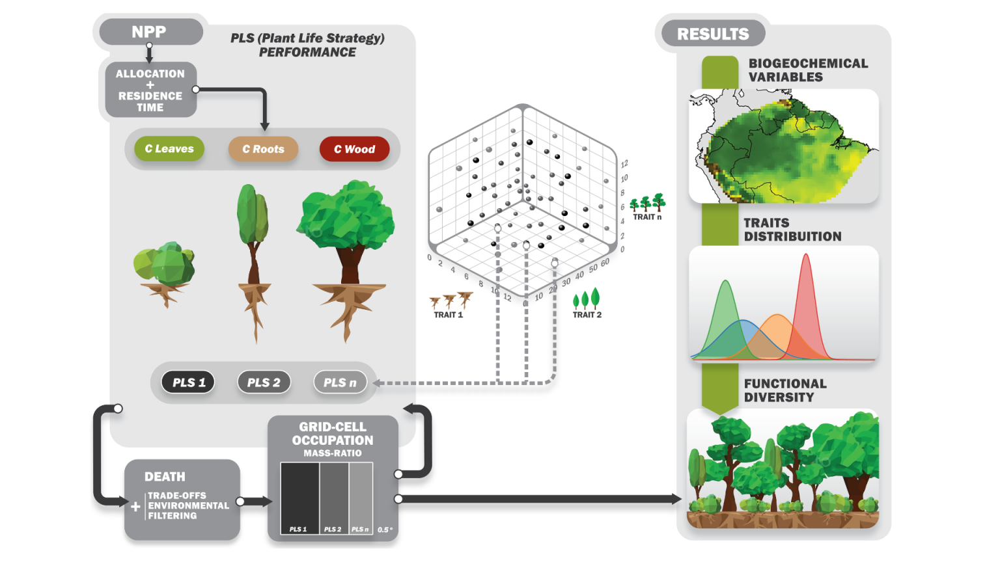
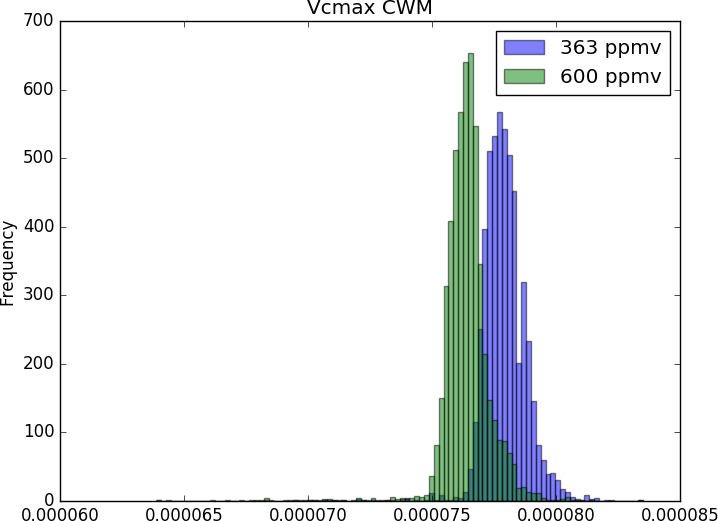

LabTerra - Modelo CAETÊ
=======================

CAETÊ – Carbon and Ecosystem functional Trait Evaluation
--------------------------------------------------------

O estudo de atributos funcionais e a ecologia funcional são campos pouco explorados pela modelagem ecossistêmica baseada em processos. Entende-se aqui que um atributo funcional é qualquer aspecto mensurável de um organismo que reflete o que ele faz, como ele interage com outros organismos e seu ambiente, e que influencia sua performance de vida, reprodução e evolutiva. Desse modo a diversidade funcional separa entidades biológicas de maneira discreta ou continua, enquanto que a diversidade taxonômica faz essa separação de maneira exclusivamente discreta. Vários estudos (p. ex. Díaz et al. 2016 Nature) mostram que a (co-)variação em atributos chaves de plantas – como densidade de madeira ou massa da semente – é determinante para a morfologia, ecofisiologia e os nichos que são ocupados em um dado ecossistema.

Os modelo globais de vegetação dinâmica (DGVMs) têm historicamente utilizado um número bastante reduzido de tipos funcionais de plantas (os PFTs) para representar a enorme diversidade – funcional e taxonômica – existente nos trópicos. Isso por que os atributos funcionais que descrevem cada PFT são constantes no tempo e espaço nesses DGVMs convencionais. Nesse contexto, o CAETÊ tem como premissa que alguns atributos funcionais possam ter valores variantes dentro do modelo e que o número de PFTs, ora chamados estratégias de vida de plantas (PLS), possam ser consideravelmente mais numerosos que nos DGVMs convencionais. Os atributos funcionais nos quais o modelo foca atualmente são: área foliar específica, densidade de madeira, altura da planta, conteúdo de nitrogênio e fósforo nas folhas e sensibilidade da condutância (g1). Procura-se garantir no modelo que “trade-offs” estejam associados a cada atributo variante, de modo a evitar o surgimento de “super-plantas” inexistentes nos registros observacionais.

   **CAETÊ Flowchart.**

No início de cada simulação primeiramente o usuário determina o número N de PLS a ser simulado; em seguida o modelo faz uma seleção semi-aleatória de valores dos atributos funcionais variantes e constrói N combinações numérica diferentes com os valores selecionados. A seleção é semi-aleatória pois os limites superiores e inferiores do valor de cada atributo são fornecidos como entrada para o modelo baseando-se em dados observados, e também pelo fato de que, havendo a disponibilidade de dados observados, uma curva de distribuição de frequência determina a probabilidade de seleção de determinados valores. Em seguida o modelo calcula os fluxos e estoques de carbono, água, nitrogênio e fósforo para cada célula de grade, para cada um dos N PLS sendo simulados. Mecanismos de exclusão de PLS, seja por filtro climático ou competição entre PLS é o que determina a variação da ocorrência de determinado PLS no tempo e espaço. Mas não é só a ocorrência de PLS que o modelo simula, mas também a distribuição geográfica e temporal da frequência de valores dos atributos funcionais variantes, por exemplo através de métricas de médias ponderadas pela comunidade (community-weighted means).

Desse modo, além de poder explorar questões científicas em biogeoquímica (p.ex. fluxos e estoques de carbono e água), o CAETÊ permite a investigação de questões relacionadas à diversidade funcional do ecossistema (p.ex. como a diversidade funcional é afetada pelo aumento de CO2 atmosférico?), nas suas diferentes vertentes: riqueza, redundância e divergência. Isso aproxima o CAETÊ da teoria e prática em ecologia de comunidades. Além disso, a representação de tipos de plantas de modo menos discretizado e mais contínuo permite simular mudanças mais sutis na vegetação em resposta a mudanças ambientais.

O CAETÊ é um modelo dinâmico (como um DGVM normal) e roda em escala global (escala espacial de um grau), mas pode ter suas simulações restritas a regiões ou até mesmo localidades específicas do planeta.

Perguntas, colaboração ou código-fonte? Escreva para labterra@unicamp.br

* CAETÊ é uma palavra em Tupi que significa “mato verdadeiro, mata com árvores grandes, mata virgem”.

.. toctree::
   :maxdepth: 2
   :caption: Contents:

   modules/modules
   model-structure
   input-data
   setup
   build-and-run
   tutorials